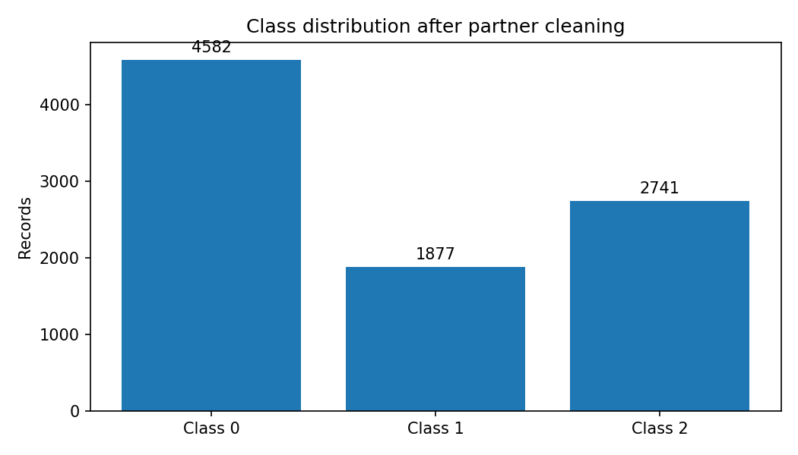
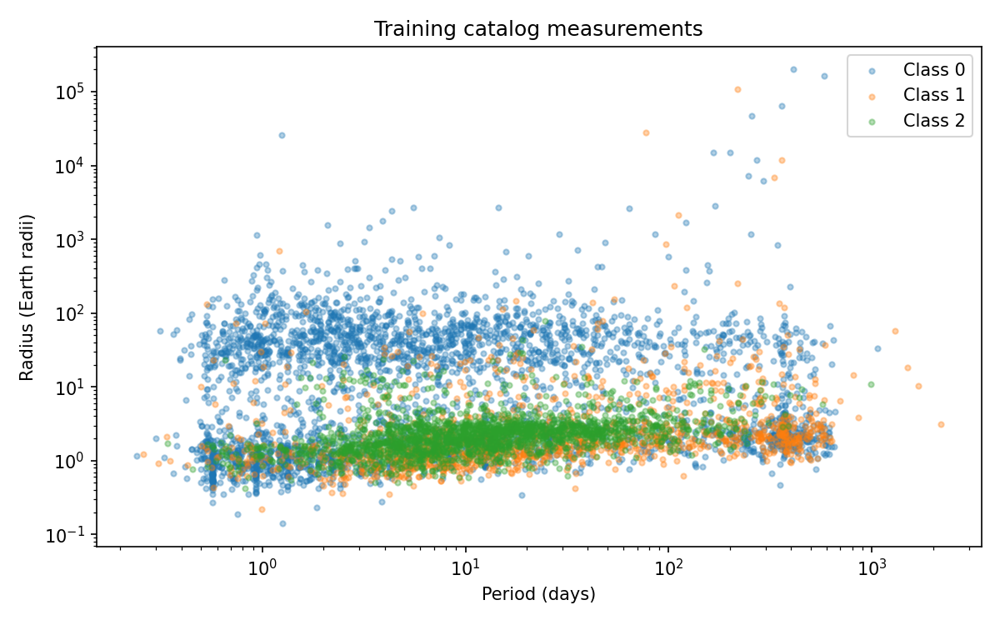
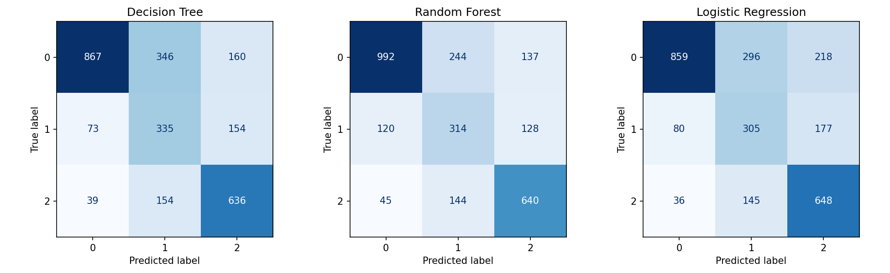

# Detecting Exoplanets from Stellar Light Curves

**Team Project Hail Mary ? Finley Blaylock and Noah Manuel**

Our objective is to compare machine-learning approaches for distinguishing exoplanet-related dispositions using Kepler measurements. Our dataset contains derived planetary and stellar catalog features rather than raw flux time series, so this milestone evaluates catalog classification. The team's working mapping is 0 = false positive, 1 = candidate, and 2 = confirmed; its original encoding still needs source verification. We report numeric classes to avoid treating this assumption as established fact.

## Cleaning and preprocessing completed

The original dataset has 9,564 records and 12 columns. Initial checks found no explicit missing values or duplicate rows. Our cleaning workflow flags values matching column means as suspected prior-imputation placeholders, removes 363 records with all core measurements flagged, and excludes one record under the period/insolation quality rules, leaving 9,200 records. This placeholder rule is a hypothesis, not verified reconstruction of the source data. Its use of full-dataset means is a limitation of this preliminary experiment. Large positive radii are retained pending investigation.

We excluded identifiers and `koi_score`, a disposition-confidence field that could leak target information. We split by star into 6,436 training records and 2,764 evaluation records, with no shared stars. All models use this same split. Imputation and scaling are fitted within training pipelines, and three-fold stratified group cross-validation uses training data only.

## Dataset exploration

**Figure 1.** After cleaning, class 0 has 4,582 records (49.8%), class 1 has 1,877 (20.4%), and class 2 has 2,741 (29.8%). Class imbalance means accuracy alone is insufficient: the majority baseline achieves 49.7% evaluation accuracy. Macro-F1 weights the three classes equally.

**Figure 2.** Training-only period and radius measurements span orders of magnitude, so logarithmic axes help reveal their distributions. Substantial class overlap suggests that a single threshold is insufficient. Extreme fitted radii require provenance review before physical interpretation.

## Feature engineering and preliminary results

We created ten predictors from eight original measurements: log1p transforms of period, planet radius, equilibrium temperature, insolation, and stellar radius, plus a planet-to-star radius ratio with unit conversion and a relative luminosity proxy. These features reuse existing observations. We tested Decision Tree, Random Forest, and Logistic Regression with balanced class weights, along with a majority baseline. Hyperparameters were fixed for this preliminary run.

| Approach | Training CV macro-F1 (mean ? fold SD) | Evaluation accuracy | Evaluation macro-F1 |
|---|---:|---:|---:|
| Majority baseline | 0.222 ? 0.000 | 49.7% | 0.221 |
| Decision Tree | 0.629 ? 0.017 | 66.5% | 0.644 |
| Random Forest | 0.673 ? 0.014 | 70.4% | 0.673 |
| Logistic Regression | 0.634 ? 0.027 | 65.6% | 0.630 |

Random Forest performs best at 70.4% accuracy, compared with 66.5% for Decision Tree and 65.6% for Logistic Regression. All three outperform the baseline. Logistic Regression is a useful simpler comparison, while the forest can capture nonlinear interactions. However, Random Forest's training macro-F1 is 0.913 versus 0.673 on evaluation data, indicating overfitting. Fold standard deviations are not confidence intervals, and small score differences are not conclusive.

**Figure 3.** Off-diagonal counts reveal class-specific mistakes remaining in all three models. Per-class precision, recall, F1, and one-versus-rest confusion counts are saved in `results_cleaned/classification_reports.json`.

An earlier full-data experiment is retained in `analysis.py` and `results/`. It suggested that feature engineering helps Logistic Regression, but its sample differs from this cleaned-data experiment. Its scores are not a controlled comparison with the table above. Separate feature ablations are still needed on the current training split.

## Challenges and remaining work

Verify the numeric label encoding and placeholder assumptions, investigate extreme fitted measurements, and evaluate sensitivity to cleaning choices. Next, tune model complexity and compare feature sets using training-only group cross-validation. Consider gradient boosting as an additional approach. Further evaluation should account for repeated inspection of the current evaluation set. Direct transit detection would require actual light curves and additional preprocessing.

The integrated notebook executed without cell errors. Checks confirm that all 9,200 records are assigned to one split and no star overlaps. Four automated tests cover invalid-value handling, predictor exclusions, original-experiment split/prediction alignment, and radius conversion.

## Team contributions

- **Finley Blaylock:** Co-developed the project roadmap with Noah and is processing the dataset. Finley is also working with Noah on diagrams and visualizations.
- **Noah Manuel:** Co-developed the project roadmap with Finley and located the dataset. Noah is also working with Finley on diagrams and visualizations.

This draft and implementation were prepared with AI assistance. Both team members should review the code, reproduce the results, and ensure any required course disclosure is accurate before submission.

Sources: [dataset](https://www.kaggle.com/datasets/gauravkumar2525/kepler-exoplanet-dataset/data); [NASA catalog field definitions](https://exoplanetarchive.ipac.caltech.edu/docs/API_kepcandidate_columns.html).
